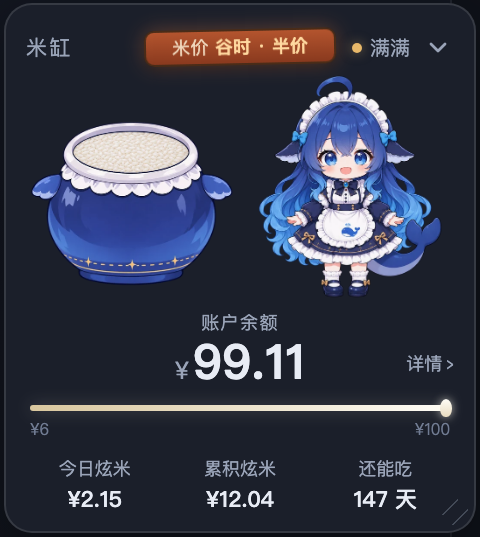
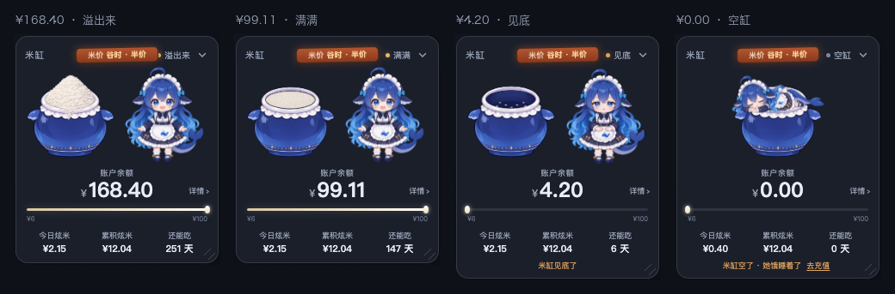

# Rice vat · dsh-rice-vat

[中文](https://github.com/zyzfred/dsh-rice-vat/blob/main/README.md) | **English**

> Turn your DeepSeek **account** balance into a vat of rice. The whale girl guards it and takes a bite whenever you spend. Today's rice, all-time rice, and the days-left estimate all follow the account, not this machine.

[](https://www.npmjs.com/package/dsh-rice-vat)
[](LICENSE)
[]()



---

## Install

### Option 1: ask the DSH agent (easiest)

Start a new session and say:

> Install the DSH plugin `dsh-rice-vat`, latest version

Approve the `plugin_manager` confirmation.

### Option 2: manual

```
plugin_manager  install_bundle  dsh-rice-vat@1.1.0
```

or:

```bash
npm install -g dsh-rice-vat
```

### ⚠️ Fully quit DSH and reopen it after installing

A page refresh is not enough. The plugin has two halves: the client panel and the Host (routes, account usage, commands). The client can load on refresh, but the Host must restart and register its routes. If you only refresh, the panel appears and stays on "measuring rice" because the Host half is not up.

If it still looks wrong after a restart, toggle `dsh-rice-vat` off and on in **Plugins**.

### Requirements

| Item | Requirement |
|---|---|
| DSH | **≥ 0.2.2-rc.2** (account-level usage needs `deepseekAccount.getPlatformSession()`) |
| Plugin | **1.1.0** |
| DeepSeek account | **signed in**; balance and account usage come from the signed-in account |
| API key | **not required**; the plugin never reads one |

> Older DSH versions can still show balance and the vat, but **Today**, **All-time**, and **Days left** show `—` and the panel marks account data unavailable.

---

## What it does

### 🍚 Balance as rice level

- **> ¥100** — a mountain of rice overflowing the vat
- **¥6 – ¥100** — a continuous rice surface dropping inside the opening
- **¥0 – ¥6** — only a few grains at the bottom
- **¥0** — empty vat; she falls asleep on the rim

The continuous band keeps a tiny minimum at ¥6, so crossing the boundary never makes the rice increase. The ¥6 and ¥100 boundaries share one layered vat composition, crossfaded.

### 📊 Account-wide spend

- **Today's rice** — DeepSeek Platform account spend today, not a local session estimate.
- **All-time rice** — Platform's lifetime `total_costs` counter, across API keys, clients, and machines.
- **Days left** — balance divided by the trailing 7 full-day average (today excluded).
- The rice-price sign shows peak/off-peak; update time lives in Details.

> The local ledger still exists, but only drives the bite animation and a clearly-labelled local estimate. It never masquerades as the account total.

### 🐋 Eating animation

Each model consumption switches to the 16-frame, 4.6-second eating loop. The decrease amount rises from **inside the vat opening**, holds briefly, then fades. Frequent spend does not restart the animation repeatedly; it keeps looping. The vat itself keeps showing the real balance.

### 🪧 States

| Situation | Label |
|---|---|
| balance > ¥100 | Overflowing |
| ≥ 70% | Full |
| 30–70% | Half |
| < 30% | Low |
| empty | Empty |
| signed out | Signed out |
| delayed | Data delayed · last HH:MM |
| failed | Covered + Retry |

The status stays truthful while she eats; the bite amount is a separate floating number inside the vat.

### 🖱️ Desktop-pet behaviour

- **Default pill**: rice grain + balance + days left, small and unobtrusive.
- **Drag**: drag the expanded card anywhere except buttons, or drag the whole pill.
- **Resize**: drag the corner grip, use arrow keys when focused, or double-click the grip to reset to 100%.
- **Memory**: expanded/collapsed, position, and size persist across refreshes and restarts.
- **Always on top**: mounted in `shell.overlay` with a top-layer z-index.
- **Details**: principal/bonus, price period, update time, usage details, top-up, reset layout.
- **Top safe inset**: the widget cannot be dragged into the window chrome (macOS traffic lights / Windows caption), where it would receive no pointer events.

### ⌨️ Commands

```
/rice-vat off     # hide the visual; billing and usage recording continue
/rice-vat on      # show it again
```

Host-level command; works from any session. The visual switch is written to `$DSH_HOME/rice-bowl/ui.json` and shared by every page.

### 🌐 Chinese and English

- Follows the DSH UI language: Simplified Chinese / English.
- All visible copy, buttons, and aria labels go through the Client locale dictionaries.
- Other DSH locales fall back to English.

---

## Four tiers



| Balance | Vat | Implementation |
|---|---|---|
| **> ¥100** | mountain | `vat-overflow` art |
| **¥6 – ¥100** | continuous surface | empty vat + masked rice overlay |
| **¥0 – ¥6** | a few grains | `vat-low` art |
| **¥0** | empty + sleeping girl | `vat-empty` + `girl-sleep` |

---

## Data sources

| Field | Source |
|---|---|
| Balance / paid / bonus | `ctx.deepseekAccount.getBalance()` (Host) |
| All-time rice | `GET /api/v0/users/get_user_summary` → `data.biz_data.total_costs` |
| Today / daily | `GET /api/v0/usage/by_api_key/cost` (fallback `/api/v0/usage/cost`) |
| Days left | balance ÷ trailing 7 full-day account average |
| Bite animation | `assistant/message.usage` session events, folded on the Host |

### Account usage endpoints

These are DeepSeek Platform **dashboard** endpoints, not public API endpoints. The Host uses the platform grant DSH already stores:

```
GET {platformOrigin}/api/v0/users/get_user_summary
GET {platformOrigin}/api/v0/usage/by_api_key/cost?start=…&end=…&tz=…
GET {platformOrigin}/api/v0/usage/cost?month=…&year=…   # fallback
```

- Uses `x-dsh-auth-token`; Bearer is a compatibility fallback.
- The token never leaves the Host and never enters `/state`, `/diag`, or the page globals.
- If an endpoint changes or fails, balance still works; Today/All-time show `—` + "Account data unavailable" instead of silently falling back to local numbers.
- Usage is cached for 60 seconds; `/pulse` reads the cache.

### Local price table (bite animation / local estimate only)

| Model | Input (cache hit) | Input (cache miss) | Output |
|---|---|---|---|
| `deepseek-flash` | ¥0.04 / ¥0.02 | ¥2 / ¥1 | ¥8 / ¥4 |
| `deepseek-v4-pro` | ¥0.30 / ¥0.15 | ¥9.0 / ¥4.5 | ¥27.0 / ¥13.5 |

First price is peak, second is off-peak (exactly half). Chinese public holidays are not modelled; local estimates can overstate. Account totals use Platform's `total_costs`.

---

## Privacy

- **Never reads an API key**; only the signed-in account service.
- Balance and account usage leave the Host only through owner-authorised routes. The Host mints a page token and injects it; the client sends `x-rice-bowl-token`.
- Tokens are stored as SHA-256 hashes in `$DSH_HOME/rice-bowl/tokens.json` (0600).
- The local ledger lives in `$DSH_HOME/rice-bowl/ledger.json`; it stores amounts and token counts only, and is never uploaded.
- Account usage caches only aggregates (today/all-time/daily), not raw responses or the grant.
- The visual switch is `$DSH_HOME/rice-bowl/ui.json` with `{ visible: true|false }`.

---

## Known limitations

- **Platform dashboard endpoints are private** and may change; failures preserve the last aggregate and mark it delayed instead of crashing.
- **Account usage can lag**; `total_costs` is the authoritative lifetime counter; today/daily come from the usage dashboard.
- **All-time includes every API key and off-app spend**; today/daily come from the Platform usage console and may only cover API usage. The local ledger covers this app only and is labelled separately.
- **The local ledger does not backfill history**; it only drives the animation.
- **The overlay is always on top**; use `/rice-vat off`, or drag/resize it out of the way.
- **Top chrome is reserved**: the widget cannot sit on the macOS traffic lights / Windows caption because those are window drag regions.
- **The price sign is centred in the title row**, sharing the row with the title and status; details live to the right of the balance.
- **Peak/off-peak** uses Beijing weekdays 9–12 and 14–18; Chinese public holidays are not modelled.

---

## Development

With a local link install: `index.js` triggers a Host reload; `client.js` needs a page refresh; `package.json` / `locale` / new assets need a full DSH restart. See [DEV.md](https://github.com/zyzfred/dsh-rice-vat/blob/main/DEV.md).

```bash
node --test scripts/test-platform-usage.mjs   # usage parsing/fallback
node --test scripts/test-host-command.mjs     # /rice-vat on|off
node --test scripts/test-host-state.mjs       # account usage + /state
node scripts/dev-check.mjs                    # diag + assets + account
```

`/diag` contains no amounts, only counters, account/usage availability, cache age, UI switch, and command registration.

---

## Credits

The character, technical direction, and implementation approach come from the open-source community.

### 1. Character · whale girl / big fat fish

- Community asset library: **[TreapGoGo/deepseek-whale-girl](https://github.com/TreapGoGo/deepseek-whale-girl)** (MIT)
- The library states it is community-maintained and **does not represent DeepSeek or any official position**
- This package's artwork was regenerated by the author with AI tooling, based on that community character design, and is MIT-licensed with this package

### 2. Development references

- **[Sutera-Diffusus/dsh-whale-musume](https://github.com/Sutera-Diffusus/dsh-whale-musume)** (MIT) — early `shell.overlay` and read-only asset routing reference
- **[huangdsa45/dsh_feiyu](https://github.com/huangdsa45/dsh_feiyu)** (MIT) — desktop-pet-style overlay proof
- **[MeteorNOX/DeepSeek-Balance-Whale-Widget](https://github.com/MeteorNOX/DeepSeek-Balance-Whale-Widget)** (MIT) — balance-drop accounting idea
- **[aceice01/dsh-whale-pet](https://github.com/aceice01/dsh-whale-pet)** — Host-side balance proxy and client-only results

### 3. Platform

- **[DeepSeek Harness](https://deepseek-harness.github.io/deepseek-harness/)** — third-party community plugin in its ecosystem

### 4. Disclaimer

**This is not an official DeepSeek project.** It is not affiliated with, endorsed by, or connected to DeepSeek / 深度求索, and does not use their trademarks as its own brand.

---

## License

**MIT** — code and artwork share one licence. See [LICENSE](LICENSE) and [assets/ATTRIBUTION.md](assets/ATTRIBUTION.md).

---

## Uninstall

```
plugin_manager  remove_bundle  dsh-rice-vat
```

Then restart DSH.

---

<div align="center">

### If the rice vat made your balance glanceable

**Star the repo ⭐**

It really does get the whale girl a few more bites 🍚

[](https://github.com/zyzfred/dsh-rice-vat/stargazers)
[](https://github.com/zyzfred/dsh-rice-vat/fork)

</div>
