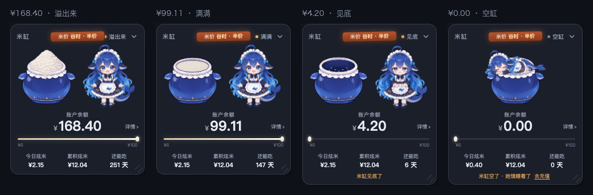

# 米缸 · dsh-rice-vat

> 把 DeepSeek **账号**余额变成一缸米。鲸鱼娘守着缸，你每花一笔，她就吃一口；今日炫米、累积炫米和“还能吃几天”都跟着账号走，不是跟着这台机器走。

[中文](https://github.com/zyzfred/dsh-rice-vat/blob/main/README.md) | [English](https://github.com/zyzfred/dsh-rice-vat/blob/main/README.en.md)

[](https://www.npmjs.com/package/dsh-rice-vat)
[](LICENSE)
[]()


---

## 安装

### 方式一：让 DSH 的 agent 帮你装（最简单）

新建一个会话，对它说：

> 安装 DSH 插件 `dsh-rice-vat`，最新版

它调用 `plugin_manager` 时会弹确认，批准即可。

### 方式二：手动

```
plugin_manager  install_bundle  dsh-rice-vat@1.1.0
```

或者命令行：

```bash
npm install -g dsh-rice-vat
```

### ⚠️ 装完必须**完全退出 DSH 再打开**

不是刷新页面，是**退出应用**。

插件由两半组成：客户端（面板 UI）和 Host（数据路由、账号用量）。客户端刷新页面就能加载，**Host 半必须等 DSH 重新启动才会注册路由**。只刷新不重启，就会看到「面板出现了但一直显示正在读数」—— 那是 Host 半没起来。

如果重启后仍不正常，到「插件」页把 `dsh-rice-vat` 的开关**关掉再打开**。

### 运行要求

| 项 | 要求 |
|---|---|
| DSH | **≥ 0.2.2-rc.2**（账号级用量依赖 `deepseekAccount.getPlatformSession()`） |
| 插件版本 | **1.1.0** |
| DeepSeek 账号 | **需要登录**，余额与账号用量通过已登录账号读取 |
| API Key | **不需要**，插件完全不读 key |

> 旧版 DSH 仍可显示余额和米缸，但“今日炫米 / 累积炫米 / 还能吃几天”会显示 `—`，并标记账号数据暂不可用。

---

## 它有什么

### 🍚 余额就是米位

不是又一个数字，而是**余光扫一眼就知道还剩多少**。

- **> ¥100** — 米堆成小山，溢出缸口
- **¥6 – ¥100** — 米面在缸口内**连续下降**
- **¥0 – ¥6** — 缸底只剩几粒米
- **¥0** — 空缸，她直接趴在缸口上睡着

米面在 ¥6 附近保留了最小米量，掉到 ¥6 不会出现“米反而变多”；¥6 / ¥100 两个边界都走同一套分层淡换。

### 📊 账号级消耗

- **今日炫米**：DeepSeek Platform 账号今日消耗（不是本机会话的估算）。
- **累积炫米**：Platform 的**终身消费计数器** `total_costs`，跨 API Key、跨客户端、跨本机。
- **还能吃 N 天**：按近 7 天日均消耗估算（今天不计入日均）。
- 米价木牌：谷时半价、高峰原价，长款居中放在标题行，与「米缸」和状态同一行；详情按钮在账户余额数字右侧。

> 本机账本仍然存在，但只用于“她吃了一口”的动画和本机估算，不会冒充账号总额。

### 🐋 吃米动画

每产生一次模型调用消耗，她就切到「端着碗吃米饭」的 16 帧动画（4.6 秒循环）。减少的金额会从**缸口内部**升起、短暂停留后淡出，不与余额数字或状态牌重叠。高频消耗时不会反复重启动画，保持连续循环；米缸本身不参与演出，始终显示真实余额。

### 🪧 状态与提示

提示牌说明的是**米缸/账号当前状态**，不再被“正在炫米”覆盖：

| 情形 | 提示 |
|---|---|
| 余额 > ¥100 | 溢出来 |
| 米位 ≥ 70% | 满满 |
| 米位 30–70% | 过半 |
| 米位 < 30% | 见底 |
| 空缸 | 空缸 |
| 未登录 | 还没开缸 |
| 数据延迟 | 数据延迟 · 上次 HH:MM |
| 读取失败 | 盖着布 + 重试 |

吃米时，标题旁会额外出现“吃米中”小徽标；状态文字保持真实状态。

### 🖱️ 浮在桌面上的米缸

- **默认是小米粒药丸**：米粒 + 余额 + 还能吃几天，尽量不挡工作区。
- **拖动**：拖展开卡片的任意非按钮区域，或整个药丸，到任意位置。
- **缩放**：右下角斜纹手柄拖动，或聚焦手柄后用方向键；双击手柄恢复 100%。
- **记忆**：展开/收起、位置、大小都会记住；刷新页面、重开 DSH 后保持。
- **置顶**：挂在 `shell.overlay` 上，z-index 拉到最上层，像桌面宠物一样浮在最上面。
- **详情**：本金/赠金、米价时段、更新时间、用量明细、去充值、重置位置和大小。

### ⌨️ 命令开关

```
/rice-vat off     # 只隐藏视觉，计费/用量记录照常
/rice-vat on      # 重新显示
```

命令是 Host 级的，任意会话都能用；`off` 不会停止账本和账号用量刷新。宿主会把视觉开关写入 `$DSH_HOME/rice-bowl/ui.json`，所有页面共享。

### 🌐 中英文

- 跟随 DSH 的界面语言：中文 / English。
- 所有可见文案、按钮、aria 标签都走 Client locale 字典，不是硬编码中文。
- 其他 DSH 语言回退到英文。

---

## 四档米位



| 余额 | 米位 | 实现 |
|---|---|---|
| **> ¥100** | 米堆成小山 | `vat-overflow` 原画 |
| **¥6 – ¥100** | 米面连续下降 | 空缸 + 米面叠加层，按余额在缸口内下移 |
| **¥0 – ¥6** | 缸底几粒米 | `vat-low` 原画 |
| **¥0** | 空缸，她趴在上面睡 | `vat-empty` + `girl-sleep` |

---

## 数据从哪来

| 字段 | 来源 |
|---|---|
| 余额 / 充值 / 赠金 | `ctx.deepseekAccount.getBalance()`（Host） |
| 累积炫米 | `GET /api/v0/users/get_user_summary` → `data.biz_data.total_costs` |
| 今日炫米 / 近 30 天逐日 | `GET /api/v0/usage/by_api_key/cost`（月中回退 `/api/v0/usage/cost`） |
| 还能吃几天 | 余额 ÷ 近 7 个完整日的账号日均消耗 |
| 本机吃米动画 | 会话事件 `assistant/message.usage`，在 Host 折叠 |

### 账号用量接口

这两个是 DeepSeek Platform **控制台接口**，不是公开 API；插件通过 DSH 已保存的 platform grant 在 Host 侧请求：

```
GET {platformOrigin}/api/v0/users/get_user_summary
GET {platformOrigin}/api/v0/usage/by_api_key/cost?start=…&end=…&tz=…
GET {platformOrigin}/api/v0/usage/cost?month=…&year=…   # 回退
```

- 请求头使用 `x-dsh-auth-token`；Authorization Bearer 作为兼容回退。
- token 永远不离开 Host，不进入 `/state`、`/diag` 或页面全局。
- 接口失败/改版时，余额仍可用；今日/累积会显示 `—` 并标记“账号数据暂不可用”，不会退回本机数字冒充账号。
- 账号用量缓存 60 秒；`/pulse` 只读缓存，不重复打接口。

### 本机计价表（仅用于吃米动画和本机估算）

| 模型 | 输入（缓存命中） | 输入（未命中） | 输出 |
|---|---|---|---|
| `deepseek-flash` | ¥0.04 / ¥0.02 | ¥2 / ¥1 | ¥8 / ¥4 |
| `deepseek-v4-pro` | ¥0.30 / ¥0.15 | ¥9.0 / ¥4.5 | ¥27.0 / ¥13.5 |

前为高峰价，后为空闲价（正好半价）。**中国法定节假日未建模**，本机估算会高估；账号总额以 Platform 的 `total_costs` 为准。

---

## 隐私与鉴权

- **完全不读取 API key**，只走已登录的账号服务。
- 余额与账号用量只通过 **owner 授权的路由**离开 Host：Host 在渲染页面时签发一次性令牌并注入页面全局，客户端回传 `x-rice-bowl-token` 才放行。
- 令牌以 **SHA-256 哈希**落盘（`$DSH_HOME/rice-bowl/tokens.json`，权限 0600），进程重启或插件重载都不会让已打开的页面失效。
- 本机账本在 `$DSH_HOME/rice-bowl/ledger.json`，只存金额和 token 数，不上传任何东西。
- 账号用量只缓存聚合值（今日/总额/逐日），不缓存 Platform 原始响应，也不缓存 grant。
- 视觉开关在 `$DSH_HOME/rice-bowl/ui.json`，只是 `{ visible: true|false }`。

---

## 已知限制

- **Platform 控制台接口是私有接口**，可能随 DeepSeek 改版；插件会在失败时保留上次聚合值并标记延迟，不会崩。
- **账号用量可能有延迟**；`total_costs` 是权威终身计数器，今日/逐日来自 usage 控制台，更新频率以 Platform 为准。
- **累积炫米是账号终身 `total_costs`，包含所有 API Key 与站外消费**；今日/逐日来自 Platform usage 控制台，可能只覆盖 API 用量。本机账本只统计本应用，两者口径不同，详情里有说明。
- **本机账本不回填历史**；它只驱动吃米动画，安装前的消耗不会补进本机估算。
- **叠加层始终置顶**；如果挡住工作区，用 `/rice-vat off` 隐藏，或拖动/缩放到不碍事的位置。
- **侧边栏折叠时**，浮层仍可能压住内容；默认药丸 + 位置记忆 + 命令开关是当前的缓解方式。
- **米价木牌**的峰谷判断按北京时间工作日 9–12、14–18；中国法定节假日未建模。

---

## 开发

本地 link 安装时，改 `index.js` 会触发 Host 重组；改 `client.js` 需要刷新页面；改 `package.json` / `locale` / 新增素材需要完全退出 DSH 再打开。详见 [DEV.md](https://github.com/zyzfred/dsh-rice-vat/blob/main/DEV.md)。

```bash
node --test scripts/test-platform-usage.mjs   # 账号用量解析/回退
node --test scripts/test-host-command.mjs     # /rice-vat on|off
node scripts/dev-check.mjs                   # diag + 素材 + 账号状态
node scripts/dev-check.mjs --token <tok>      # 再验 /state 与 /pulse
```

`/diag` 不含任何金额，只有账号/用量计数、是否有今日/总额/日均、缓存年龄和命令注册状态。

---

## 开源来源与致谢

这个插件的**角色形象、技术路线和实现手法**都来自开源社区，来源在此逐一说明。

### 1. 角色形象 · 鲸鱼娘 / 大肥鱼

本插件的鲸鱼娘沿用**社区自发形成的去中心化角色**。该角色没有官方标准设定，本项目也不主张任何人设的“正统性”。

- 社区资产库：**[TreapGoGo/deepseek-whale-girl](https://github.com/TreapGoGo/deepseek-whale-girl)**（MIT）
- 该资产库明确声明：由社区维护，**不代表深度求索公司或其官方立场**
- 本项目的立绘在设计该库角色设定的基础上，由本项目作者用 AI 图像工具重新生成，随本包以 MIT 授权

### 2. 开发期参考的素材与实现

- **[Sutera-Diffusus/dsh-whale-musume](https://github.com/Sutera-Diffusus/dsh-whale-musume)**（MIT）—— 开发早期曾短暂使用其四张立绘（已全部删除，不再随包分发）；其 `shell.overlay` 挂载方式、素材只读路由的做法是本项目的重要参考
- **[huangdsa45/dsh_feiyu](https://github.com/huangdsa45/dsh_feiyu)**（MIT）—— 证明了 `shell.overlay` 浮层可以作为桌面宠物式的挂载点
- **[MeteorNOX/DeepSeek-Balance-Whale-Widget](https://github.com/MeteorNOX/DeepSeek-Balance-Whale-Widget)**（MIT）—— 展示了「余额下降即消耗」的记账思路
- **[aceice01/dsh-whale-pet](https://github.com/aceice01/dsh-whale-pet)** —— 演示了 Host 侧代理余额接口、前端只拿结果的隔离做法

### 3. 运行平台

- **[DeepSeek Harness](https://deepseek-harness.github.io/deepseek-harness/)** —— 本插件是其生态内的第三方社区插件

### 4. 声明

**本项目不是 DeepSeek 官方项目**，与深度求索公司无隶属、合作或背书关系，不使用其商标或标识作为自身品牌。

---

## 许可

**MIT** —— 代码和美术**整包同许可**，可自由使用、修改、再分发，详见 [LICENSE](LICENSE) 与 [assets/ATTRIBUTION.md](assets/ATTRIBUTION.md)。

---

## 卸载

```
plugin_manager  remove_bundle  dsh-rice-vat
```

然后重启 DSH。

---

<div align="center">

### 如果这个米缸让你一眼看懂了余额

**给个 Star ⭐ 吧**

它真的会让鲸鱼娘多吃几口米 🍚

[](https://github.com/zyzfred/dsh-rice-vat/stargazers)
[](https://github.com/zyzfred/dsh-rice-vat/fork)

</div>
