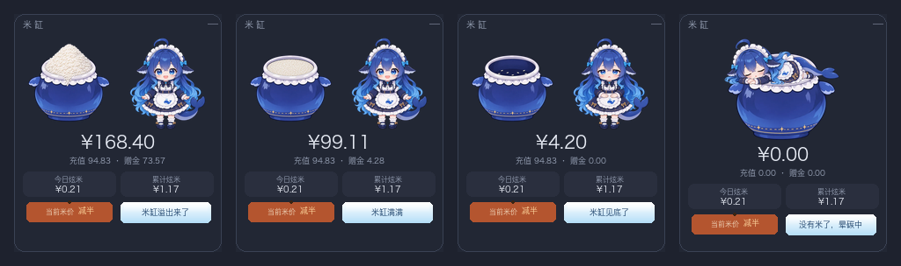

# 米缸 · dsh-rice-vat

> 把 DeepSeek 账户余额变成**一缸米**。鲸鱼娘守着缸，你每花一笔，她就吃一口。

[](https://www.npmjs.com/package/dsh-rice-vat)
[](LICENSE)
[]()


---

## 安装

### 方式一：让 DSH 的 agent 帮你装（最简单）

新建一个会话，对它说：

> 安装 DSH 插件 `dsh-rice-vat`，最新版

它调用 `plugin_manager` 时会弹确认，批准即可。

### 方式二：手动

```
plugin_manager  install_bundle  dsh-rice-vat@1.0.2
```

或者命令行：

```bash
npm install -g dsh-rice-vat
```

### ⚠️ 装完必须**完全退出 DSH 再打开**

不是刷新页面，是**退出应用**。

插件由两半组成：客户端（面板 UI）和 Host（数据路由）。客户端刷新页面就能加载，**Host 半必须等 DSH 重新启动才会注册路由**。只刷新不重启，就会看到「面板出现了但一直显示正在读数」—— 那是 Host 半没起来。

如果重启后仍不正常，到「插件」页把 `dsh-rice-vat` 的开关**关掉再打开**。

### 运行要求

| 项 | 要求 |
|---|---|
| DSH | **≥ 0.2.1-rc.2** |
| 插件版本 | **≥ 1.0.2**（1.0.0 / 1.0.1 在 0.2.1 上不可用，`1.0.1` 已标记 deprecated） |
| DeepSeek 账号 | **需要登录**，余额通过账号服务读取 |
| API Key | **不需要**，插件完全不读 key |

---

## 它有什么

### 🍚 余额就是米位

不是又一个数字，而是**余光扫一眼就知道还剩多少**。

- **> ¥100** — 米堆成小山，溢出缸口
- **¥6 – ¥100** — 米面在缸口内**连续下降**（不是四段跳变）
- **¥0 – ¥6** — 缸底只剩几粒米
- **¥0** — 空缸，她直接趴在缸口上睡着

### 🐋 吃米动画

每产生一次模型调用消耗，她就切到「端着碗吃米饭」的 16 帧动画（4.6 秒循环），米粒从碗里溅出，碗里的米**越吃越少直到见底**。米缸本身不参与演出，始终显示真实余额。

### 🪧 气泡提示牌

一块蓝白渐变的提示牌，用一句话说明**米缸当前的状态**（不是描述她在干嘛）：

| 情形 | 提示 |
|---|---|
| 余额 > ¥100 | 米缸溢出来了 |
| 米位 ≥ 70% | 米缸满满 |
| 米位 30–70% | 米缸过半 |
| 米位 < 30% | 米缸见底了 |
| 空缸 | 没有米了，晕碳中 |
| 吃米中 | 正在炫米... |
| 数据拉取失败 | 信号不稳 |

### 🏷️ 米价木牌

DeepSeek 有峰谷计价：北京时间工作日 9–12、14–18 为高峰，其余时段**半价**。空闲时段木牌会亮成橙色显示「当前米价 · 减半」。

### 📊 本地消耗统计

今日炫米 / 累计炫米，按真实 token 用量折算成金额，落在本地账本。

---

## 四档米位



| 余额 | 米位 | 实现 |
|---|---|---|
| **> ¥100** | 米堆成小山 | `vat-overflow` 原画 |
| **¥6 – ¥100** | 米面连续下降 | 空缸 + 米面层按余额在缸口内下移（最大 19.05%） |
| **¥0 – ¥6** | 缸底几粒米 | `vat-low` 原画 |
| **¥0** | 空缸，她趴在上面睡 | `vat-empty` + `girl-sleep`（上移 52%） |

中间段没有现成原画，用素材包自带的缸口遮罩 + 米面叠加层合成，所以升降是平滑的而不是跳档。

---

## 数据从哪来

| 字段 | 来源 |
|---|---|
| 余额 / 充值 / 赠金 | `ctx.deepseekAccount.getBalance()`（Host） |
| 今日 / 累计消耗 | 会话事件 `assistant/message.usage`，在 Host 折叠 |
| 实时余额 | 锚点余额 − 锚点后累计消耗，1.5 秒一次心跳 |
| 计价 | 内置 DeepSeek 官方价目表 |

### 计价表（元 / 百万 tokens）

| 模型 | 输入（缓存命中） | 输入（未命中） | 输出 |
|---|---|---|---|
| `deepseek-flash` | ¥0.04 / ¥0.02 | ¥2 / ¥1 | ¥8 / ¥4 |
| `deepseek-v4-pro` | ¥0.30 / ¥0.15 | ¥9.0 / ¥4.5 | ¥27.0 / ¥13.5 |

前为高峰价，后为空闲价（正好半价）。**中国法定节假日未建模**，节假日流量会高估。未知模型按 flash 计价。

---

## 隐私与鉴权

- **完全不读取 API key**，只走已登录的账号服务。
- 余额数据只通过 **owner 授权的路由**离开 Host：Host 在渲染页面时签发一次性令牌并注入页面全局，客户端回传 `x-rice-bowl-token` 才放行。
- 令牌以 **SHA-256 哈希**落盘（`$DSH_HOME/rice-bowl/tokens.json`，权限 0600），进程重启或插件重载都不会让已打开的页面失效。
- 账本在 `$DSH_HOME/rice-bowl/ledger.json`，只存金额，不上传任何东西。

---

## 已知限制

- **侧边栏折叠时**卡片可能压住内容 —— 它挂在 `shell.overlay` 上做视觉锚定，不占布局位。右上角 `—` 可收起成小米粒药丸。
- **统计从安装那一刻开始**，不回填历史消耗（避免全量重放会话日志）。
- **DSH 之外**用同一账号花的钱会降低余额，但不会被归因到今日/累计。

---

## 开源来源与致谢

这个插件的**角色形象、技术路线和实现手法**都来自开源社区，来源在此逐一说明。

### 1. 角色形象 · 鲸鱼娘 / 大肥鱼

本插件的鲸鱼娘沿用**社区自发形成的去中心化角色**。该角色没有官方标准设定，本项目也不主张任何人设的「正统性」。

- 社区资产库：**[TreapGoGo/deepseek-whale-girl](https://github.com/TreapGoGo/deepseek-whale-girl)**（MIT）
- 该资产库明确声明：由社区维护，**不代表深度求索公司或其官方立场**
- 本项目的立绘在设计该库角色设定的基础上，由本项目作者用 AI 图像工具重新生成，随本包以 MIT 授权

### 2. 开发期参考的素材与实现

- **[Sutera-Diffusus/dsh-whale-musume](https://github.com/Sutera-Diffusus/dsh-whale-musume)**（MIT）—— 开发早期曾短暂使用其四张立绘（已全部删除，不再随包分发）；其 `shell.overlay` 挂载方式、素材只读路由的做法是本项目的重要参考
- **[huangdsa45/dsh_feiyu](https://github.com/huangdsa45/dsh_feiyu)**（MIT）—— 证明了 `shell.overlay` 浮层可以作为桌面宠物式的挂载点
- **[MeteorNOX/DeepSeek-Balance-Whale-Widget](https://github.com/MeteorNOX/DeepSeek-Balance-Whale-Widget)**（MIT）—— 展示了「余额下降即消耗」的记账思路
- **[aceice01/dsh-whale-pet](https://github.com/aceice01/dsh-whale-pet)** —— 演示了 Host 侧代理余额接口、前端只拿结果的隔离做法

### 3. 运行平台

- **[DeepSeek Harness](https://deepseek-harness.github.io/deepseek-harness/)** —— 本插件是其生态内的第三方社区插件

### 4. 声 明

**本项目不是 DeepSeek 官方项目**，与深度求索公司无隶属、合作或背书关系，不使用其商标或标识作为自身品牌。

如果你在这些上游项目里发现了有用的东西，也请给它们一个 Star。

---

## 许可

**MIT** —— 代码和美术**整包同许可**，可自由使用、修改、再分发，详见 [LICENSE](LICENSE) 与 [assets/ATTRIBUTION.md](assets/ATTRIBUTION.md)。

---

## 卸载

```
plugin_manager  remove_bundle  dsh-rice-vat
```

然后重启 DSH。

---

<div align="center">

### 如果这个米缸让你一眼看懂了余额

**给个 Star ⭐ 吧**

它真的会让鲸鱼娘多吃几口米 🍚

[](https://github.com/zyzfred/dsh-rice-vat/stargazers)
[](https://github.com/zyzfred/dsh-rice-vat/fork)

</div>
