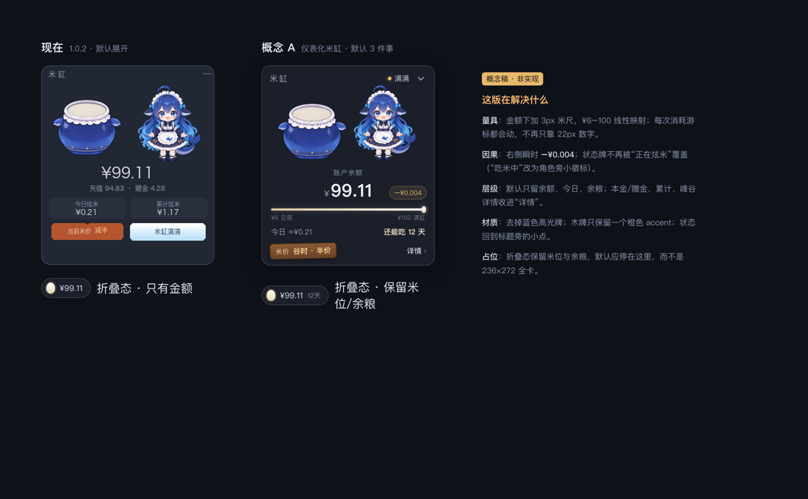

# 米缸 · UI/UX 设计审查

> **实施状态（1.1.0）**：本文中的账号级用量、显式状态机、默认药丸/位置记忆、拖动/缩放、`/rice-vat on|off`、中英文 UI、米尺与“还能吃 N 天”已落地；本文保留为设计依据，1.0.2 的标注图保留作对比。

> 审查对象：`dsh-rice-vat@1.0.2`（`client.js` / `index.js` / `locale` / `assets`）
> 配图：`docs/review-annotated.png`（现状审计）、`docs/proposal-concept.png`（概念 A）
> 结论：**美术资产是强项，当前短板在“量具感、因果感、状态诚实、占位方式”四件事上。**

---

## 0. 一句话结论

米缸不是一个“余额仪表盘”，而是**把余额变成体感、把花钱变成看得见的一口、再用鲸鱼娘提供陪伴**的环境型小部件。

它现在最打动人的是“缸 + 鲸鱼娘 + 木牌”的世界观；最该修的不是画，而是：

1. **米位读不出“还剩多少”**——它目前是档位，不是量具。
2. **花钱没有落到米缸上**——她吃了，但缸里的米、金额、状态三者没有形成因果。
3. **未知/未登录/失败时，米缸在“撒谎”**——加载中显示满缸，未登录显示空缸睡觉。
4. **默认展开的 236×272 浮层，在 IDE 里是负担**——遮挡、拦截点击、不记忆折叠。

---

## 1. 我理解的产品契约

| 层级 | 要解决的问题 | 用户的实际问题 |
|---|---|---|
| 余光层 | 扫一眼知道“还够不够” | 我还能不能继续跑这个任务？ |
| 事件层 | 每次消耗有一口“咬下去”的反馈 | 刚才那一下花了多少？ |
| 情绪层 | 鲸鱼娘的状态让数字有生命 | 这缸米还撑得住吗？要不要充？ |
| 事实层 | 余额、今日、累计、峰谷价 | 我到底花了多少，为什么？ |

**设计原则（建议写进后续 PR 的验收标准）**

1. **隐喻不能骗人**：不知道余额时，不能画满缸；未登录时，不能画“没米了”。
2. **角色承担情绪，数字承担事实**：可爱的话放在提示牌，精确的话放在副文案。
3. **只在变化时动**：角色可以一直呼吸；UI 道具不要一直漂。
4. **不打扰**：默认占位要小，展开是用户主动行为，展开后才拦截点击。
5. **3 秒可答**：余额多少、今天花了多少、还够不够。

---

## 2. 现在做得好的地方

- **隐喻统一**：米缸、米位、吃米、米价木牌、鲸鱼娘，全部在一个语义场里，比“余额卡片 + 进度条”有记忆点。
- **角色状态驱动**：idle / low / eat / sleep 四套姿态与余额档位绑定，情绪是“长在数据上”的。
- **木牌是很好的 diegetic detail**：把 DeepSeek 的峰谷计价翻译成“米价减半”，既不术语化又有信息量。
- **折叠药丸的雏形对了**：米粒 + 金额，是比整张卡更适合常驻的形态。
- **工程容错扎实**：素材重试链、SVG 兜底、Host 未就绪重试、页面令牌，这些不是 UI 但决定了 UI 能不能被信任。

---

## 3. 核心问题（按影响排序）

### P0-1 · 米位是“档位”，不是“量具”

`client.js:430` 把 ¥6–100 映射到 0–1，`client.js:160` 再把 0–1 映射到 **19.05%** 的米面位移。

- 在 110px 宽的缸上，整段行程约 **21px**。
- ¥1 ≈ **0.2px**；今天花 ¥1，米面肉眼不可见。
- 于是“余光扫一眼就知道还剩多少”实际不成立：**精确信息全在金额上，米缸只负责可爱。**

更严重的是边界：

- ¥6.01 时连续米面几乎为 0，¥6.00 切到 `vat-low` 的“缸底几粒米”，**余额往下掉，米反而变多**。
- ¥100 从“连续合成”切到 `vat-overflow` 是**不同 DOM 分支的硬切**，没有 0.55s 的缸层淡换。
- 空缸场景（`client.js:323`）把缸从 110×113 放大到 136×140，并换了一套 DOM，**归零瞬间缸会放大、角色会瞬移**。

> 这不是美术问题，是“读数层”缺失。米缸可以继续当情绪/档位，但需要一个真正的量具层。

### P0-2 · 花钱没有落到米缸上

- 吃米动画由 `recentAt` 触发（`client.js:116`），但**缸里的米不会动**；她吃的是碗里的米，缸只是“真实余额”的背景板。
- 金额 `toFixed(2)`，一次调用常常只花 ¥0.001–0.005，**数字半天不变**；`formatSmall` 又把 <¥0.01 显示成 `<0.01`（`client.js:400`），今日消耗看起来是冻住的。
- 吃米时 `hintFor` 直接返回“正在炫米...”（`client.js:383`），**覆盖了米缸状态**，与 README 说的“说明米缸当前状态，不是描述她在干嘛”自相矛盾。
- 4.6 秒的完整吃米动画对每一次微消耗都播一遍；高频 agent 会话里，她会**一直吃、卡片一直发蓝光**，从“可爱”变成“噪音”。
- 碗里的米在 4.6 秒里吃空，然后循环回满碗；但缸里的米没有同步，**“她吃的米”和“缸里的米”是两套账**。

> 用户真正想看见的是：**刚才那一下，缸里少了多少。** 现在没有这条视觉链路。

### P0-3 · 未知、未登录、失败时，状态在撒谎

| 情形 | 现在的画面 | 问题 |
|---|---|---|
| 首次加载 | 满缸 + 待机鲸鱼娘 + 金额“—” | 不知道余额时先画满缸；如果实际是空缸，会“啪”地掉下去 |
| 未登录 | 空缸 + 睡着的鲸鱼娘 + “没有米了，晕碳中” | 把“没登录”误读成“没余额”；用户不知道该去登录 |
| 请求失败（首次） | 满缸 + “读取失败 / 插件未就绪” | 同上，且技术文案出现在可爱卡片里 |
| 首次成功后失败 | 继续显示上次金额，**没有任何延迟标记** | `failed` 只在 `!loaded` 时用；`hintFor` 的 `stale` 只看 Host 的 `doc.stale`，客户端网络失败被吞掉 |
| 余额读取失败 | Host 标记 `stale`，提示“信号不稳” | 文案模糊，没有“上次更新时间”，用户无法判断还能不能信 |

> 余额是钱。**未知时必须看起来像未知**，不能像“满缸”或“空缸”。

补充一个代码级的状态错位：`mood` 取 `primary`（60s 一次的 `/state` 锚点），`tier` / `fill` 取 `live`（1.5s 的 `/pulse`）。余额跨过 ¥6 / ¥0 时，**缸先变，女孩和提示文案最多晚 60s**；极端情况下会出现“空缸 + 站着的鲸鱼娘”。客户端应该只保留一个 `shownBalance` / `tier` 作为单一事实源。

### P0-4 · 信息密度与层级：9px 小字 + 口径不清

当前卡片同时讲 7 件事：余额、充值、赠金、今日、累计、米价、状态。字号分布：

- 金额 22px；
- 标题/副文案 10–11px；
- 统计标签、木牌标签、提示牌 **9px**（`client.js:633`、`656`、`671`）。

问题不只是小，而是：

- **金额没有身份标签**：¥99.11 是余额？充值？今日？新用户只能猜。
- **“充值 94.83 · 赠金 4.28”实际是当前余额的两部分**（`index.js:502` 把钱包余额累加进 `recharge`），不是历史充值额；读起来像“我一共充了 94.83”。
- **“累计炫米”是本机账本**（`index.js:445`），不是账户终身累计；没有“自安装以来”的说明。
- **今日/累计是 token 估算**（未知模型按 flash、节假日未建模），但 UI 用 `¥0.21` 呈现得像账单精确值。
- **口径没有说清**：今日/累计只统计本应用内的 token 消耗；在 DSH 之外用同一账号花的钱只降余额、不归因。用户会看到“余额掉了，今日还是 0”。
- **两块牌子同权重**：木牌（价格）和蓝牌（状态）各占一半，最亮的蓝牌却是最低优先级的信息。
- **金额居中且宽度随位数变化**：100.00 → 99.99 时整组会横向跳一下；没有为最长位数预留宽度。

### P0-5 · 固定浮层的占位方式

`client.js:405`：

```js
{ position: 'fixed', left: 8, bottom: 56, width: 236, pointerEvents: 'auto', zIndex: 40 }
```

- 默认 `collapsed=false`，**每次刷新都重新展开**。
- 236×272 的卡片固定在侧栏左下方，整块 `pointer-events:auto`，会挡住侧栏内容与点击。
- 收起按钮是 17×13px 的“—”，命中区远小于 24×24；折叠态只有米粒 + 金额，**米位状态全丢**。
- 没有拖拽/吸附/隐藏；README 也承认“侧边栏折叠时可能压住内容”。

> 在 IDE 里，一个常驻 236×272 的浮层是很贵的。它应该是“默认小米粒，想看再展开”。

### P1 · 材质与动效不在一个世界

- 提示牌是 `linear-gradient(165deg, #fff, #e8f3ff, #b6d8f8)` + 高光 + 内阴影 + 4.6s 浮动（`client.js:660`），像 2010 年的 Web 按钮；旁边木牌却是手绘木头。**一个世界里的两种物理规则。**
- 蓝牌是全卡最亮的元素，位置却在右下角，离角色最远；它把视线从金额和角色上拉走。
- 提示牌永久上下浮动 ±1.5px；木牌不动；角色在呼吸。**三种物理规则同时存在。**
- 姿态切换（idle ↔ eat ↔ low ↔ sleep）是 `` 换 `key` 的硬切；吃米结束从“笑 + 空碗”直接跳到“站立待机”，会明显“啪”一下。
- `prefers-reduced-motion` 只停了 CSS animation（`client.js:714`），**吃米的 WebP 动画仍在播**，米面 0.9s transform 也仍在动。
- 吃米时整卡加蓝色 border + shadow（`client.js:557`），和蓝色主体混在一起，既不明显也不温暖。

### P1 · 可访问性与 i18n

- 9px 字号低于可读阈值；统计标签对比度够（约 6.6:1），但尺寸不够。
- 收起按钮只有“—”，没有 `aria-label` / `aria-expanded`；药丸只有 `title`。
- 鲸鱼娘 `` 是装饰图，应该 `alt=""` / `aria-hidden`。
- 没有 `:focus-visible` 样式；键盘用户看不到焦点。
- `locale/en.json` 没有被 `client.js` 使用，英文用户会看到全中文；而且 en 的 `scale` 写的是 “Full at ¥30”，与代码的 ¥100 不一致（`locale/en.json:16`）。
- 余额/今日/累计没有给屏幕阅读器的完整句子。

---

## 4. 建议

### 4.1 先补“量具层”，不要重画缸

**推荐：在金额下方加一条 3px 的“米尺”**，把精确量交给它，把米缸留给档位和情绪。

```
账户余额
¥99.11                         −¥0.004
▓▓▓▓▓▓▓▓▓▓▓▓▓▓▓▓▓▓▓▓░
¥6 见底                         ¥100 满缸
今日 ≈¥0.21          还能吃 12 天
```

- 轨道按 ¥6–100 线性映射，两端放 tiny 刻度；>¥100 显示“100+”，轨道满格 + 一个小山形标记。
- 轨道上放一个“米粒”游标；余额变化时游标平滑移动，**每次消耗都能看见一点点位移**。
- 如果不想加轨道，退而求其次：在金额右侧加一个 **“还能吃 N 天”**（余额 ÷ 近 7 天日均消耗），这是比“米位百分比”更有用的量具。
- 米缸的连续合成保留，但：
  - 把 ¥6 的连续米面 clamp 到 ≥5%，避免“掉到 ¥6 反而多出几粒米”；
  - 在 ¥6 / ¥100 边界用同一套分层 DOM 做 crossfade，不要换分支硬切；
  - 空缸场景保持 110×113 的舞台尺寸，或做 200ms 的 scale/opacity 过渡，避免瞬移。

> 如果只做一件事：**让米缸/米尺对“这次花了多少”有反应**。这是产品的核心承诺。

### 4.2 把“一口”做成可读的事件

- **瞬时 delta chip**：在金额右侧 1.8s 显示 `−¥0.004`（3 位小数），淡出。比整卡发光精确得多。
- **小额 vs 大额**：
  - `< ¥0.01`：1.2s 的“米粒从缸沿落下 + 角色轻微点头”，不要播完整 4.6s；
  - `≥ ¥0.01`：完整吃米动画；
  - 连续高频消耗：节流，至少间隔 6–8s 才重启动画，避免一直吃。
- **今日/累计**：小于 ¥1 时显示 3 位小数（`≈¥0.004`），不要用 `<0.01` 冻住。
- **状态不被覆盖**：提示牌继续显示“米缸满满 / 见底”；在角色旁边加一个 9–10px 的 `吃米中` 小徽标（或米粒呼吸点）。这样“米缸状态”和“她在干嘛”同时存在，不再互相覆盖。
- **因果可视化**：吃米时让米尺游标下降、缸口米面轻微下移（哪怕 1px），并让 delta chip 与之一致。三者同向，用户才信。

### 4.3 建立显式状态机，禁止“猜”

建议把现在隐含在 `mood` / `failed` / `stale` 里的状态，收敛成 7 个显式状态：

| 状态 | 触发 | 缸 | 角色 | 提示牌 | 副文案 | 主操作 |
|---|---|---|---|---|---|---|
| `loading` | `doc === null && !failed` | 降透明/骨架 | 待机降透明 | 正在量米… | 正在读取账户余额 | — |
| `not-ready` | Host 路由未起 | 盖布/降透明 | 不显示 | 米缸盖着布 | 重启 DSH 后生效 | 重试 |
| `signed-out` | `signedIn === false` | 空缸（或盖布） | **待机张望，不睡** | 还没开缸 | 登录后显示余额 | 去登录 |
| `live` | 正常 | 档位/连续 | idle/low | 满满/过半/见底 | 本金/赠金 | 详情 |
| `eating` | `recentAt` 新鲜 | 同 live | eat | **保持 live 文案** | 刚刚吃掉 ≈¥0.004 | — |
| `stale` | `doc.stale` 或首次成功后请求失败 | 上次读数，降透明 | 同 live | 数据延迟 | 上次 12:03 | 重试 |
| `error` | 首次请求失败 | 降透明/盖布 | 不显示 | 米缸盖着布 | 数据没接上 · 重启 DSH | 重试 |
| `empty` | 余额 0 | 空缸 | sleep | 米缸空了 | 她饿睡着了 · 去充点米 | 去充值 |

关键：**`signed-out` 和 `empty` 必须是两个不同的画面**；`loading` 和 `error` 绝不能画满缸。Host 已经返回 `links.topUpUrl` / `usageUrl`（`index.js:492`），客户端目前没用，正好接 CTA。

### 4.4 占位：默认小米粒，展开是主动行为

- **默认 `collapsed=true`**，首次运行可展开一次做发现，之后记住用户选择（`localStorage`）。
- 折叠药丸：
  - 高度 28px，金额 10–11px；
  - 米粒本身带 3px 的“米位环”或顶部细条，保留状态；
  - 低米时米粒变琥珀色 + 一个小点；吃米时轻微跳动；
  - `aria-label="展开米缸，余额 99.11 元"`。
- 展开态：
  - 用 `position: fixed` 可以，但**只让按钮/可交互区域 `pointer-events:auto`**，卡片空白区 pass-through；
  - 记住展开/收起；
  - 可选拖拽 + 吸附四角，位置持久化；
  - 如果 DSH 有侧栏 dock slot，优先 dock，而不是 overlay。
- 如果保留“展开后 236×272”，至少让它**不要默认挡在侧栏历史记录上**；默认药丸是性价比最高的修法。

### 4.5 层级：默认只讲 3 件事，其余进“详情”

默认卡片建议只保留：

1. 角色 + 米缸（情绪/档位）
2. **账户余额**（大数字 + 标签）
3. **今日消耗 + 还能吃 N 天**（事件/决策）
4. 一条米尺（量具）
5. 米价 + 状态（一行，弱化）

把“充值/赠金、累计、安装时间、峰谷时段、按模型拆分、上次更新”收进一个 `详情 ›` 展开层（或 hover tooltip）。这样：

- 9px 小字可以升到 10–11px；
- 卡片更短，遮挡更少；
- 信息主次真正成立。

### 4.6 材质：一个世界，四种材料

| 元素 | 材料 | 做法 |
|---|---|---|
| 米缸 | 深蓝陶瓷 | 保留原画；加地面软阴影 |
| 提示牌 | 米纸/陶瓷小牌 | 暖白 #f5ecd8、深蓝字、1px 金线；去掉高光带、内阴影、永久浮动 |
| 米价 | 木牌 | 保留；只在一个时段切换时轻摆一次 |
| 文字 | 墨 | 深蓝黑；金额用暖白 |

- 取消吃米时整卡蓝色 glow；如果要强调，在碗/角色后方加 8px 暖色柔光，或让米粒游标短暂发亮。
- 颜色系统：DSH 中性色 + 海蓝 + 米白 + 少量金；**橙色只给“谷时半价”一个地方**，不要和 low 状态抢。
- 字号系统：金额 24 / 主标签 12 / 元信息 10；不再出现 9px。
- 地面阴影：给缸和角色各加一个 6–8px 的椭圆 soft shadow，解决“浮在卡片上”的问题。

### 4.7 动效：只在变化时动

| 对象 | 现在 | 建议 |
|---|---|---|
| 待机 | `rb-bob` 3.4s ±2px | 保留，降到 ±1.5px / 3.6s |
| 低米 | `rb-tremble` 2.6s ±1px | 改成 3.8s 慢摆 ±1px，加 1px 下沉（担心，不是发抖） |
| 睡觉 | 4.8s rotate -0.6/-1.4° | 保留；可选一个 2.4s 的 “z” 淡出 |
| 吃米 | 4.6s 完整循环 / 每次消耗 / 整卡 glow / 7 粒飞溅 | 小额 1.2s 点头 + 1 粒落下；大额完整 4.6s；去掉 glow；飞溅 3 粒；进出 200ms crossfade |
| 姿态切换 | `` 硬切 | 双层 opacity 160–200ms crossfade；预加载下一姿态 |
| 米面 | 0.9s transform | 600ms；变化 <0.5px 时不动；6/100 边界 crossfade |
| 提示牌 | 4.6s 永久 float ±1.5px | 取消常驻浮动；文案变化时 180ms scale 1.02 + fade |
| 木牌 | 静态 | 时段切换时 250ms 轻摆一次 |
| reduced motion | 只停 CSS animation | 吃米改用 `girl-eat-still`；停米面 transition / 飞溅 / 浮动 |

原则：**角色可以呼吸，UI 道具不要一直漂；动效是状态变化的标点，不是背景音乐。**

### 4.8 可访问性 / i18n 最小清单

- 所有可点击目标 ≥24×24px（桌面）/ 44×44（触屏）；收起按钮换成 chevron + 24px hit area。
- `:focus-visible` 2px 暖白 ring。
- 卡片 `role="region" aria-label="米缸 · DeepSeek 余额"`；按钮 `aria-label` / `aria-expanded`。
- 鲸鱼娘图 `alt="" aria-hidden="true"`；米缸图已经是空 alt。
- 给屏幕阅读器一句完整摘要：`账户余额 99.11 元，今日消耗约 0.21 元，米缸满满`；不要对每次消耗做 aria-live，避免刷屏。
- 文案外置：要么接 `locale/*.json`，要么删除 en；en 的 `scale` 修正为 “Full at ¥100 · bare at ¥6”。
- 数字用 `tabular-nums`（已有）+ 固定最小宽度，避免金额居中跳动。

---

## 5. 文案重写表

> 规则：**提示牌 = 一句世界观（≤8 字）；副文案 = 事实/行动（平实）；技术错误不上提示牌。**

| 位置 | 现在 | 建议 | 理由 |
|---|---|---|---|
| 金额上方 | 无 | `账户余额` | 首次使用必须知道 99.11 是什么 |
| 余额构成 | `充值 94.83 · 赠金 4.28` | `本金 94.83 · 赠金 4.28` | 实际是当前余额的两部分，不是历史充值 |
| 今日 | `今日炫米 ¥0.21` | `今日消耗 ≈¥0.21` | 估算是事实；“炫米”可以留在状态里 |
| 累计 | `累计炫米 ¥1.17` | `本机累计 ≈¥1.17` + tooltip“自安装以来” | 不是账户终身累计 |
| 米价 | `当前米价 减半` / `原价` | `谷时 · 半价` / `高峰 · 原价` | 说清楚是什么时段；tooltip 写工作日 9–12、14–18 |
| 吃米 | 提示牌 `正在炫米...` | 提示牌保持 `米缸满满`；角色旁 `吃米中` | 状态与动作分开，不再互相覆盖 |
| 空缸 | `没有米了，晕碳中` | `米缸空了 · 她饿睡着了` | “晕碳”暗示吃撑，语义反了；空缸是她饿着睡 |
| 未登录 | 空缸 + `没有米了，晕碳中` | 提示牌 `还没开缸`；副文案 `登录后显示余额`；CTA `去登录` | 未登录 ≠ 没余额 |
| 加载 | `正在读数…` / 提示牌 `—` | `正在量米…` | 世界观一致；`—` 看起来像坏了 |
| 失败 | `读取失败` / `插件未就绪 · 请重启 DSH` | 提示牌 `米缸盖着布`；副文案 `数据没接上 · 重启 DSH 后生效`；`重试` | 技术信息放副文案，给行动 |
| 延迟 | `信号不稳` | `数据延迟 · 上次 12:03` + 琥珀点 | 具体、可判断 |
| 低米 | `米缸见底了` | 保留；可加 `快没米了` / `去充值`（详情层） | 低米需要行动，但别用红色恐吓 |
| 折叠态 | `展开米缸` | `展开米缸 · 余额 99.11` | 药丸本身没有标题，读屏需要 |

**保留**：“米缸溢出来了”“米缸满满”“米缸过半”“米缸见底了”——这四句已经有画面感，不要改。

---

## 6. 建议的默认布局（概念）



> 左：当前卡片；右：概念 A。概念稿用于讨论层级与量具，不是已实现效果。

```
┌ 米缸                              ⌄ ┐
│         [米缸]      [鲸鱼娘]          │
│                                       │
│            账户余额                   │
│            ¥99.11        −¥0.004      │
│    ▓▓▓▓▓▓▓▓▓▓▓▓▓▓▓▓▓▓▓▓░            │
│    ¥6 见底                 ¥100 满缸  │
│                                       │
│    今日 ≈¥0.21        还能吃 12 天    │
│  [谷时 · 半价]              [详情 ›]  │
└───────────────────────────────────────┘
```

- 状态（满满/过半/见底）可以放在标题右侧的小字/小点，或作为米尺上方的 10px 标签；不再单独占一块高亮牌。
- 如果保留提示牌，把它做成**靠在缸边的小米纸牌**，而不是右下角的蓝色亮块。
- 详情层再放：本金/赠金、本机累计、峰谷时段、7 日柱、按模型、上次更新、去充值。

---

## 7. 优先级路线图

### P0 · 先修信任与因果（1–2 天）

1. 吃米/消耗的 delta chip + 3 位小数 + 小额/大额动效分级。
2. 显式状态机：loading / signed-out / empty / error 分开；未知不画满缸。
3. `signed-out` 不再睡；`empty` 文案改为“饿睡着了”。
4. 默认折叠 + `localStorage` 记忆 + 药丸 28px + 米位环。
5. 收起按钮 24px 命中区 + `aria-label`；金额加“账户余额”标签。
6. `prefers-reduced-motion` 真正停掉 eat WebP 与米面 transition。
7. 首次成功后请求失败 → `数据延迟 · 上次 12:03`。

### P1 · 再修量具与层级（3–5 天）

8. 米尺 / “还能吃 N 天”二选一（或都做：米尺给量，天数给决策）。
9. 默认只留 3 个数据点，其余进详情；9px → 10–11px。
10. 统一材质：米纸提示牌、去高光/去浮动、地面阴影、一个橙色 accent。
11. 姿态/缸层 crossfade；6/100 边界统一分层；空缸不再放大瞬移。
12. `tabular-nums` + 金额固定宽度；`¥6` 连续米面 clamp，避免“掉到 ¥6 反而多几粒”。
13. 吃米时保留状态牌 + 角色旁 `吃米中` 徽标；去掉整卡蓝光。
14. 可访问性最小清单：focus ring、aria、装饰 alt、24px targets。

### P2 · 再做“有用”（按需）

15. `还能吃 N 天` 的 7 日均值 + 置信说明（样本不足时显示“样本不足”）。
16. 米价倒计时 / 下一个时段 / “省 50%”；tooltip 写高峰时段。
17. 详情层：7 日柱、按模型、上次更新、刷新、去充值。
18. i18n：接 locale 或删 en；修 `¥30` 旧文案。

---

## 8. 验收标准（建议）

- 3 秒内，新用户能回答：**余额多少？今天花了多少？还够不够？**
- 一次 ¥0.004 的消耗，2 秒内至少有一个可见变化（delta chip / 米尺 / 米面 / 角色）。
- 任何“不知道余额”的状态，都不出现满缸；`signed-out` 与 `empty` 画面不同。
- 默认占位不超过侧栏宽度的 1/3 高度；展开/收起状态刷新后保留。
- `prefers-reduced-motion` 下没有动画 WebP、没有米面过渡、没有飞溅。
- 英文 UI 要么完整，要么不暴露；`locale` 与代码的阈值一致。
- 所有可点击目标 ≥24×24px；键盘可完成展开/收起。

---

## 9. 需要你拍板的问题

1. **默认形态**：首次展开一次后自动收起，还是从第一天就默认药丸？
2. **量具**：米尺（更精确）还是“还能吃 N 天”（更有决策感）？我倾向两者都做，米尺在上、天数在下。
3. **吃米强度**：目标用户是高频 agent 用户吗？如果是，4.6s 完整动画必须分级/节流。
4. **数据口径**：今日/累计是否接受“≈ 估算”的标签？如果不接受，需要把计价误差讲清楚。
5. **英文**：是否真的支持英文用户？不支持就删 `locale/en.json`，避免“看起来支持其实没有”。
6. **承载方式**：DSH 是否有侧栏 dock slot？有就 dock；没有就 overlay + 默认药丸 + 位置记忆。

---

*本文是设计审查，不是实现说明。配图 `docs/review-annotated.png` 标注了当前卡片的主要问题；下一步可以按 P0 直接做一版可对比的 prototype。*
